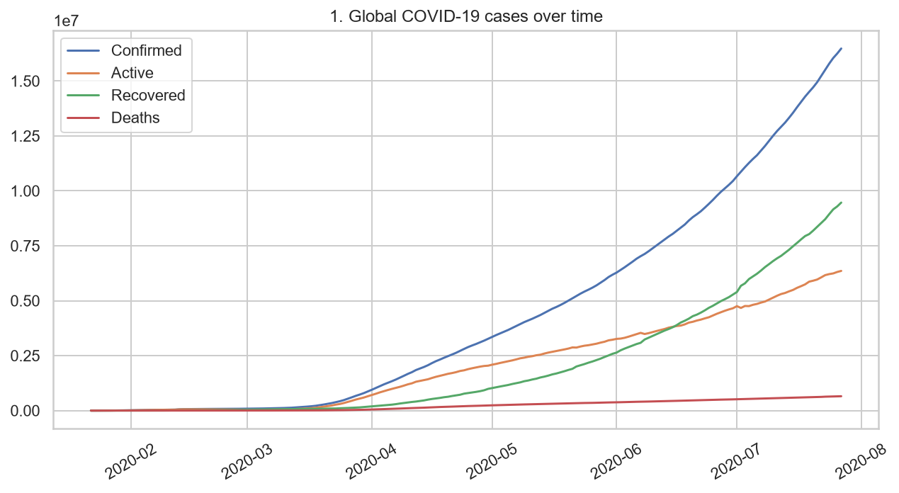
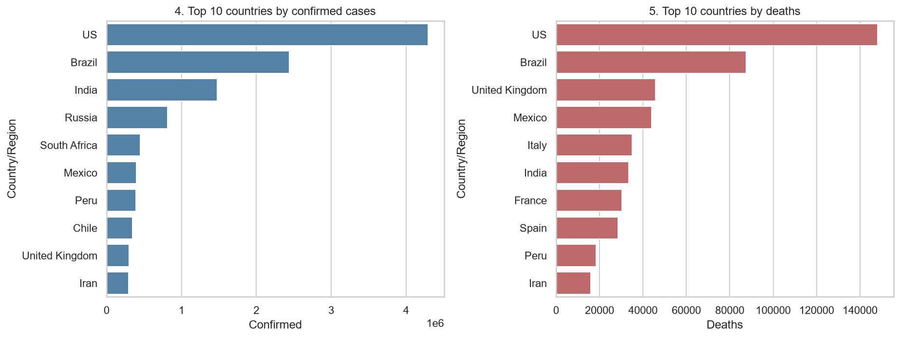
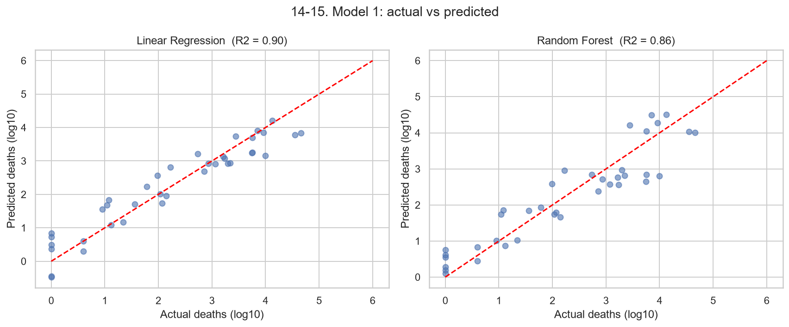
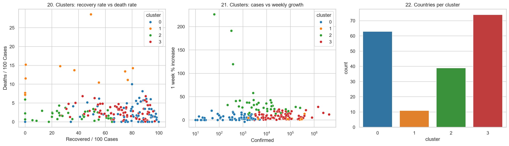

# COVID-19 Pandemic Analysis & Machine Learning

## Overview
A Data Science project analyzing global COVID-19 pandemic data using Python, data visualization, and machine learning techniques.

## Objectives
- Analyze global COVID-19 trends over time.
- Identify the top countries by confirmed cases and deaths.
- Compare recovery rates and death rates.
- Explore correlations between COVID-19 statistics.
- Predict deaths using regression models.
- Forecast confirmed cases using historical data.
- Group similar countries using K-Means clustering.

## Technologies
- Python
- Pandas
- NumPy
- Matplotlib
- Seaborn
- Scikit-learn
- Spyder IDE

## Dataset
Three datasets are used:
- `day_wise.csv`
- `country_wise_latest.csv`
- `full_grouped.csv`

## Machine Learning Models

### 1. Death Prediction
- Linear Regression
- Random Forest Regression

### 2. Confirmed Cases Forecasting
- Linear Regression
- Polynomial Regression (Degree 2)

### 3. Country Clustering
- K-Means Clustering
- StandardScaler
- Elbow Method

## Model Results

| Model | R² Score |
|---|---:|
| Linear Regression | 0.90 |
| Random Forest | 0.86 |

These scores are from the project's particular test split.

## Visualizations

### Global COVID-19 Trends


### Top Countries


### Model Predictions


### Country Clustering


## How to Run

Install dependencies:

```bash
pip install -r requirements.txt
```

Run the project:

```bash
python src/covid19_analysis.py
```

## Author
Ganesh
B.Tech Computer Science Engineering – Data Science  
Lovely Professional University

## Disclaimer
For educational and analytical purposes only. The data represents historical COVID-19 statistics.
